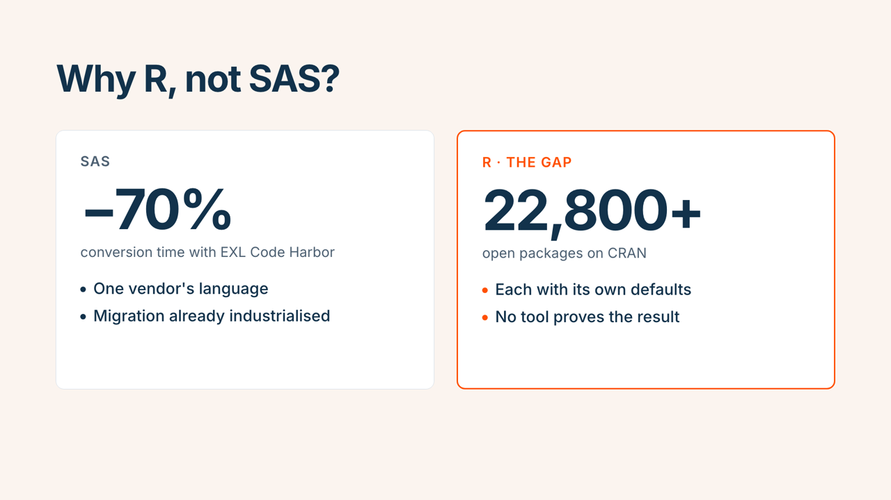
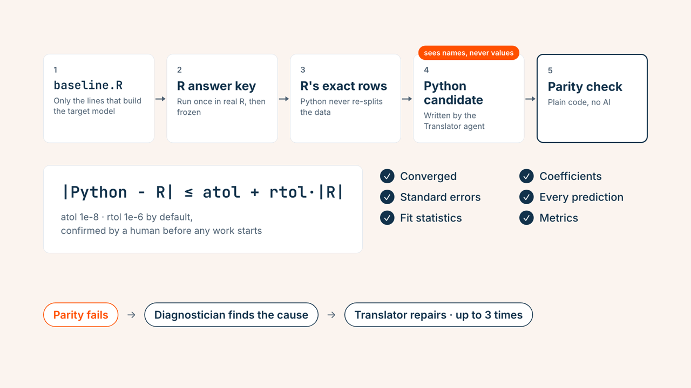
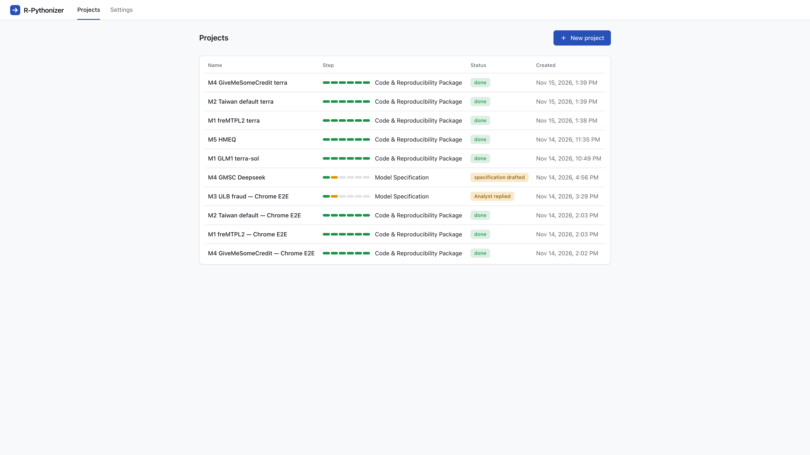
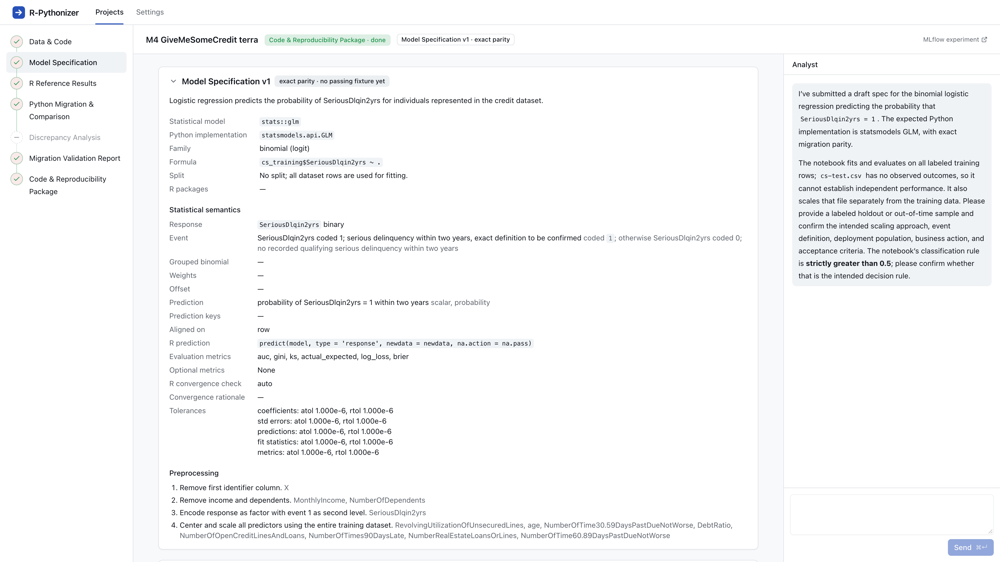
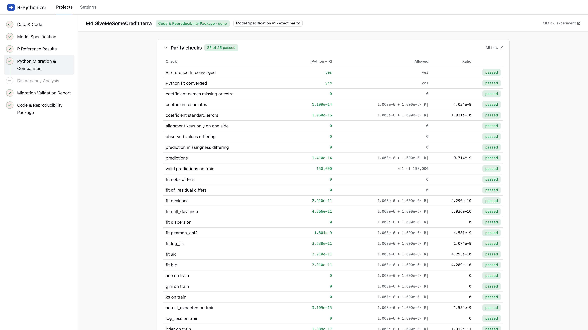
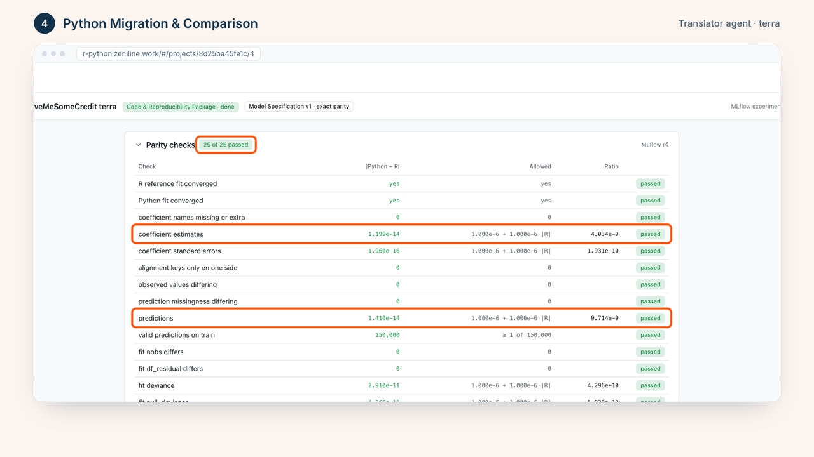
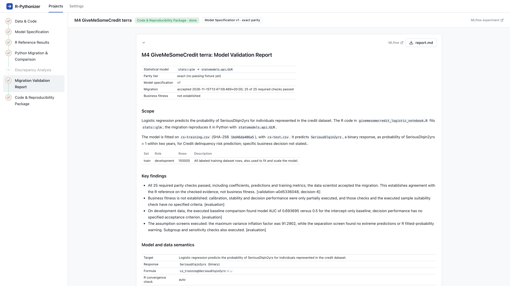
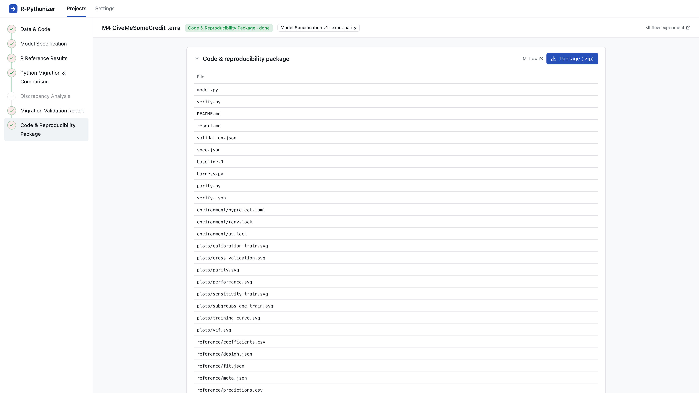

# R-Pythonizer

An agentic platform that takes a data scientist's dataset and R model code, establishes an R baseline,
translates the model to Python (statsmodels), validates it against the baseline within agreed tolerances, and
delivers the code, environments, validation results and a final report.

**Demo video:** [`video/export/R-Pythonizer_demo.mp4`](video/export/R-Pythonizer_demo.mp4) (2:51), story and a
live run on a real credit model. Script with sources: [`video/SCRIPT.md`](video/SCRIPT.md). Background for
readers new to model risk: [`TEAM_BRIEFING.md`](TEAM_BRIEFING.md).

Status: all seven build steps of [`PLAN.md`](PLAN.md) are built: the workflow, stable R and Python environments,
the four agents, validation, repair, the final report and deliverables, the React UI, restart recovery and
cancellation, and a Dockerfile and compose file for Linux.

## Why

Banks run many statistical risk models written in R, often on one person's machine. They want them in Python,
the language of their engineers and data platforms. Under PRA SS1/23 a rewrite is a model change and needs
evidence, and the same code can give different numbers in the two languages: scikit-learn adds a penalty by
default, pandas reads more values as missing, R and Python pick different reference categories.

SAS → Python migration already has industrial tools (EXL Code Harbor among them). R, with over 22,800 CRAN
packages and their own defaults, has no tool we know of that proves the result. R-Pythonizer does that.



## How it works

AI writes the Python, plain deterministic code proves it, a human approves. R runs the original model once and
its results are frozen as the answer key; Python is fitted on R's exact rows; the agent that writes Python never
sees R's numbers. Every coefficient, standard error, prediction, fit statistic and metric is then checked as
`|Python − R| ≤ atol + rtol·|R|`, with tolerances a human confirms before any work starts.



| Step | Done by | What happens |
|---|---|---|
| 1 Data & Code | code | Dataset and R code uploaded, fingerprinted (SHA-256) and profiled |
| 2 Model Specification | Analyst agent, then a human | Drafts the spec and `baseline.R`, the slice of the R code that builds the model; flags missing evidence; the data scientist confirms |
| 3 R Reference Results | code | Runs `baseline.R` once in real R and freezes coefficients, predictions, rows and fit statistics |
| 4 Python Migration & Comparison | Translator agent, code, a human | Writes `model.py` with statsmodels; parity checks; model validation (calibration, stability, subgroups, assumptions); the data scientist accepts |
| 5 Discrepancy Analysis | Diagnostician agent | Only when parity fails: finds the cause, the Translator repairs, up to 3 times |
| 6 Migration Validation Report | Reporter agent, code | Every number in the report is filled in by code and cites its evidence |
| 7 Code & Reproducibility Package | code | `model.py`, `verify.py`, the R reference, locked R and Python environments and a SHA-256 manifest |

Agents never see data rows. Approvals are bound to the hashes of the spec, baseline, code and validation they
approve. A model with no faithful Python equivalent is refused, never substituted.

Parity says the Python copies R. It does not say the model is fit for use, so the business-fitness verdict is
kept separate.

## Walkthrough: M4 GiveMeSomeCredit

A credit-default scorecard: an R notebook and 150,000 rows, fitted with `glm(family = binomial)`.

**Projects.** Every run is a project that moves through the seven steps.



**Model Specification.** The Analyst agent drafts the spec (stats::glm → statsmodels GLM, binomial logit,
tolerances 1e-6) and asks for what the notebook lacks: a labelled holdout set, the decision rule, acceptance
criteria.



**Python Migration & Comparison.** 25 of 25 parity checks pass. Coefficients agree with R to 1.2e-14 and
predictions to 1.4e-14; AUC is 0.693695 in both. No repair was needed.



Business fitness is **not established**: there is no independent evaluation set and no acceptance criteria, and
the platform lists exactly what is missing.



**Migration Validation Report** and **Code & Reproducibility Package.** `verify.py` re-runs the parity checks
against the R reference on any machine.





## AI models compared on M4

Same project, four AI models, all reaching the same verified result (23 of 23 common checks).

| AI model | Active time | Estimated cost |
|---|---|---|
| gpt-6.1-terra | 1m 24s | $0.045 |
| deepseek-flash | 2m 43s | $0.023 |
| gpt-6.1-sol | 3m 30s | $0.184 |
| grok-4.7 | 21m 37s | $1.268 |

Details and caveats: [`TEAM_BRIEFING.md`](TEAM_BRIEFING.md), section 6.3.

## Run it

```sh
./platform/bootstrap.sh                  # build the environments, the agent service and the UI (once)
cd platform/backend && uv run pytest     # tests; the M4 tests need examples/M4_givemesomecredit/data
./platform/dev.sh                        # UI on :5173; MLflow :5000, agent service :8100, control plane :8000
```

In the UI, open Settings, add a model endpoint and assign a model to each agent role. Keys are encrypted with
`platform/var/secret.key`, or with `CONTROLPLANE_SECRET_KEY` if set. The control plane also serves the built UI
(`platform/frontend/dist`) on :8000.

Bootstrap needs R 4.6.2, uv, Node 22.19 or later and a C, C++ and Fortran toolchain. R packages come from the Posit Package
Manager snapshot recorded in `platform/envs/r/renv.lock`; `./platform/bootstrap.sh relock <date>` re-resolves it.

On Linux, `docker compose -f deploy/compose.yaml up --build` (from `platform/`) runs the same stack in one image,
with steps executed as a separate unprivileged user. Ports are published on 127.0.0.1 only: the API has no
authentication.

To serve it over HTTPS, point a DNS name at the server and make ports 80 and 443 reachable. Set `R2PY_DOMAIN`
to that DNS name and `R2PY_AUTH_FILE` to the absolute path of a private file outside the checkout. Put one
`username bcrypt_hash` pair per line in that file. Generate hashes with
`docker run --rm -it caddy:2.11.9-alpine caddy hash-password`. Then run from `platform/`:

```sh
docker compose -f deploy/compose.yaml -f deploy/compose.caddy.yaml up -d --build --wait
```

Caddy obtains the TLS certificate and requires the same login for the UI, API, and MLflow at `/mlflow/`.
The web UI links to project experiments and runs there. Authorized users share the same projects and settings.

[`examples/`](examples/README.md) holds five public R models with their data, ready to upload.

The previous Agentic Model Risk Factory is in [`legacy/`](legacy/README.md) as read-only reference; its working
layout is at git tag `legacy-v2.1`.
