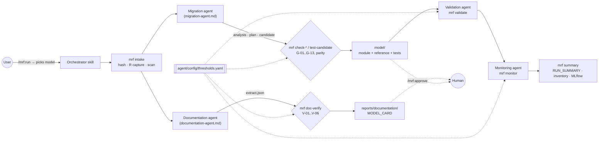
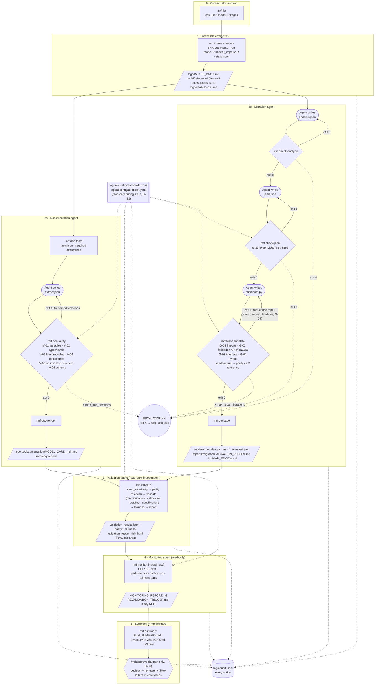
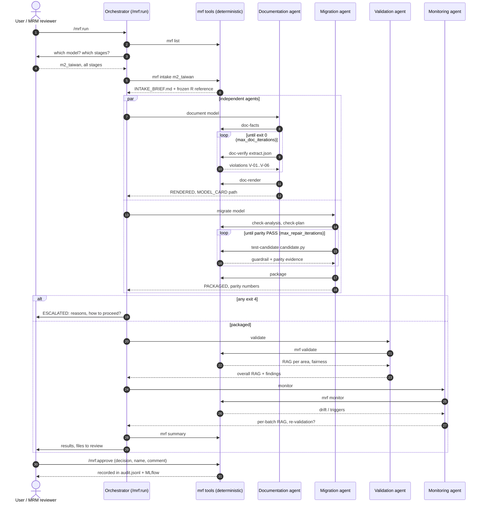
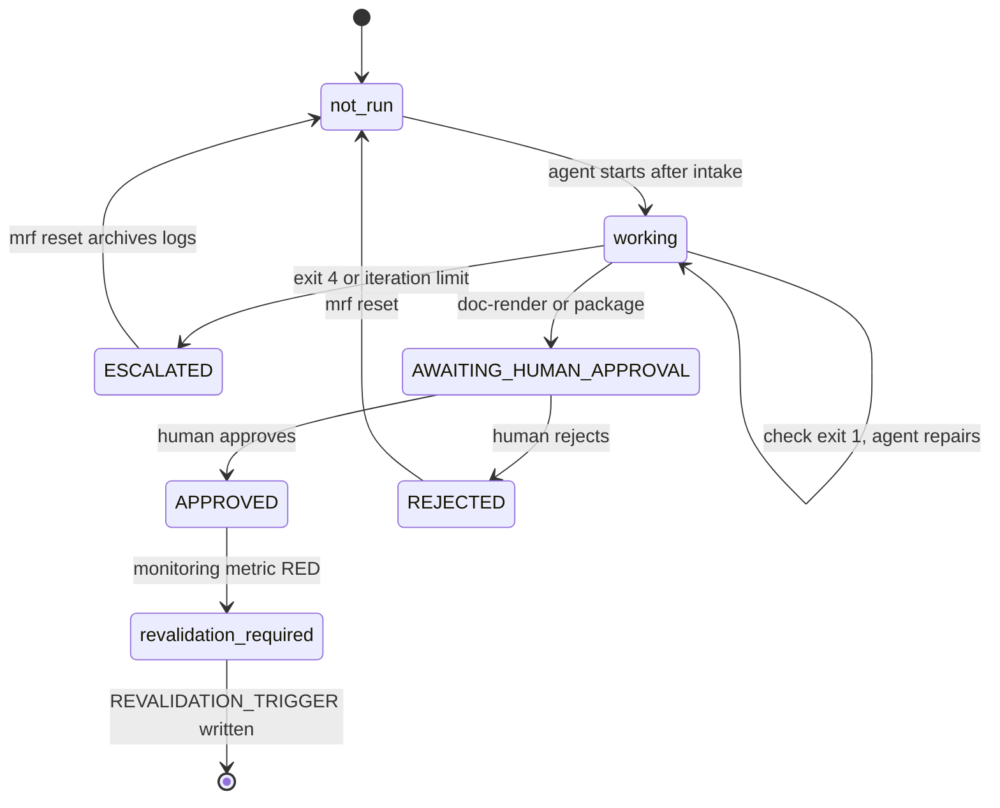

# Agentic Model Risk Factory (EXL Hackathon, Challenge 04)

Documents, redevelops, validates and monitors a bank's legacy models under PRA SS1/23. Driven from Claude Code
(or Codex) with slash commands; agents do the reasoning, deterministic tools do every check.

| Model | Type | Rows | Migration | Validation | Summary |
|---|---|---|---|---|---|
| **M1** French motor TPL claim frequency | Poisson GLM, log-exposure offset | 678,013 | parity PASS | AMBER, fairness AMBER | [`RUN_SUMMARY.md`](output/m1_fremtpl2/reports/RUN_SUMMARY.md) |
| **M2** Taiwan card default | logistic PD | 30,000 | parity PASS | AMBER, fairness RED | [`RUN_SUMMARY.md`](output/m2_taiwan/reports/RUN_SUMMARY.md) |

## Use it

In Claude Code, from this folder (load the plugin once: `claude --plugin-dir ./agent`, or
`/plugin marketplace add ./` then `/plugin install mrf@exl-hackathon`):

| Command | What happens |
|---|---|
| `/mrf:run` | asks which model in `input/` and which stages, then intake → documentation + migration agents → validation agent → monitoring agent → summary |
| `/mrf:new-model` | onboards a new legacy model into `input/<name>/` (asks you for the fields) |
| `/mrf:status [model]` | where each model stands |
| `/mrf:approve <model>` | records **your** approve/reject decision (agents never approve their own work) |
| `/mrf:monitor <model> [batch.csv]` | monitoring on a new scoring batch |

Codex reads [`AGENTS.md`](AGENTS.md) and the same skills (`.agents/skills/` → `agent/skills/`).

## Layout: three folders

```
agent/    the agents and their tools          → agent/README.md
  agents/*.md          one file per agent: what it does, its rules, the commands it must run
  skills/*/SKILL.md    the slash commands
  config/thresholds.yaml   EVERY barrier and threshold, in one file
  config/rulebook.yaml     R -> Python rules
  bin/mrf, tools/      deterministic guardrails (capture, schemas, sandbox, parity, verify, package)
  validators/          independent validation suites
input/    legacy models: model.R, model.yaml, data/, docs/   → input/README.md
output/   per model: logs/, model/, reports/  + inventory/, mlflow/   → output/README.md
```

## Flow



## Pipeline in detail

### 1. Stages, checks and loops

Agents (rounded) write work files; deterministic `agent/bin/mrf` commands (rectangles) check them. Exit 1 loops
back to the agent; exit 4 escalates to a human. Limits come from `agent/config/thresholds.yaml → agent_limits`.



### 2. Who calls whom (UML sequence)



### 3. Status of an agent's output (UML state, as shown by `mrf status`)

Applies to the documentation stage (model card) and the migration stage (Python module).



## Tests

```bash
.venv/bin/python -m pytest
```

Red-team guardrail tests, documentation-verify mutants, multi-seed parity against R, generated parity tests for
both packaged models, and wiring tests (layout, single thresholds file, agent artefacts used downstream).
