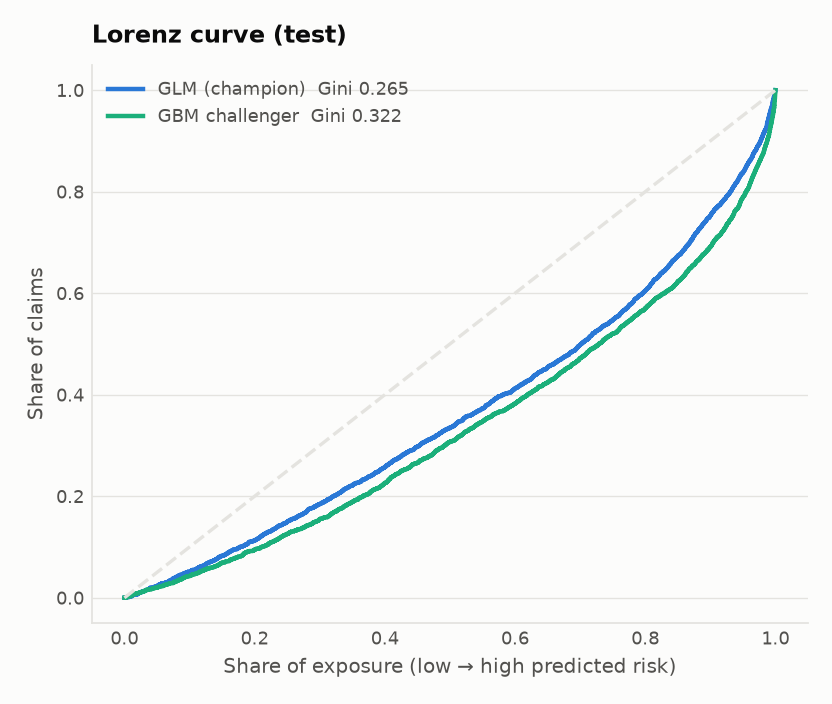
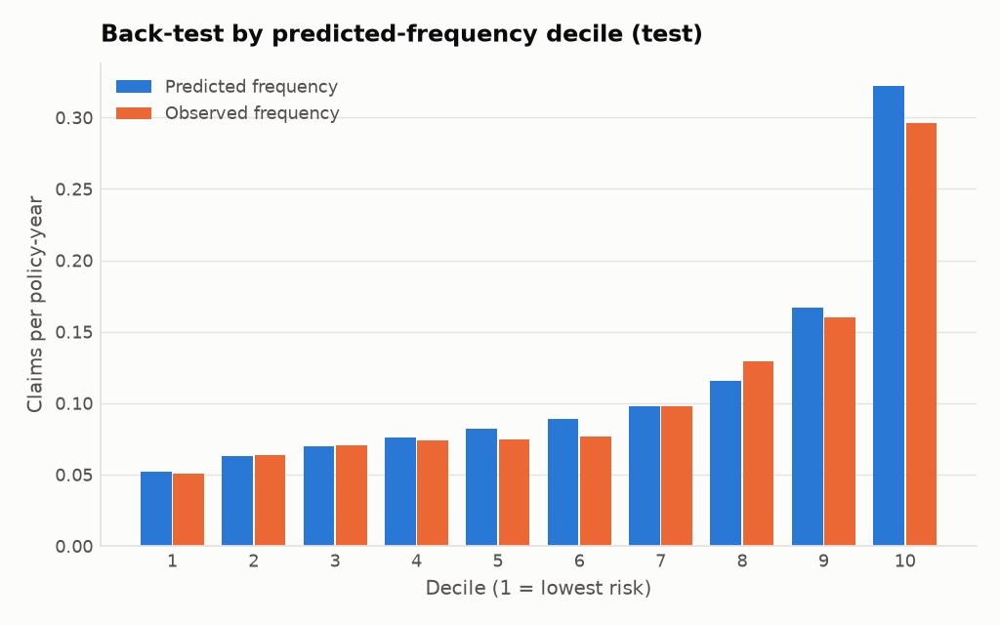
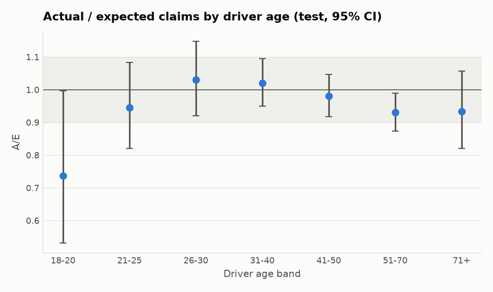

# Independent Model Validation Report: M1 French Motor TPL Claim Frequency

| | |
|---|---|
| **Model** | French Motor TPL Claim Frequency (Poisson GLM1) (`M1`), poisson/log GLM with log-exposure offset |
| **Source** | R `input/m1_fremtpl2/model.R`; developer: Reconstructed from a published actuarial case study (Noll, Salzmann & Wuthrich 2018) |
| **Model under validation** | `output/m1_fremtpl2/model/m1_fremtpl2_freq.py` (sha256 `fda45c0fbca2`), generated by the Migration Agent (Claude Opus 5.5 (Claude Code, migration-agent)); migration status AWAITING_HUMAN_APPROVAL |
| **Documentation** | `output/m1_fremtpl2/reports/documentation/MODEL_CARD_M1.md` (Documentation Agent, DRAFT - AWAITING HUMAN APPROVAL) |
| **Use** | Technical claim-frequency model feeding the motor TPL risk premium (simulated insurer) |
| **Framework** | PRA SS1/23, FCA Consumer Duty, FCA GIPP (PS21/5), UK Equality Act 2010 Sch.3 para 20A |
| **Report date** | 2026-11-13 |
| **Overall outcome** | **🟠 Amber: approved for continued use subject to F1 (exposure) and F2 (young-driver relativities)** |

## 1. Executive summary

- **The migration is exact.** The agent-generated Python module reproduces R to 1e-12 on coefficients and 6e-14 on all 678,013 expected claim counts; the validator confirmed it independently.
- **The model ranks risk.** Test Poisson loss 30.911 against 32.398 for a flat frequency, Lorenz Gini 0.265. Across 10 random splits the loss is 31.37 ± 0.31.
- **Overall level is right, the exposure assumption is not (F1).** A/E on test is 0.968, but claims scale with exposure to the power 0.45, not 1.
- **Age is used as a rating factor (F2).** It is statistically justified (LR 648 on 6 df), but the youngest band is over-charged on test.
- **A GBM challenger is materially better (F3)**, so the GLM is under-specified.

| Area | Rating | Evidence |
|---|---|---|
| Reproducibility & Python rebuild | 🟢 Green | Validator re-check **PASS** (11/11); agent needed 1 iterations. Seeded split. |
| Predictive power | 🟢 Green | Test Poisson loss 30.911 vs 32.398 for a constant frequency; Lorenz Gini 0.265 |
| Calibration & back-test | 🟠 Amber | A/E 0.968 on test; slope 0.96; 3 of 10 deciles flagged; exposure elasticity 0.45 (offset assumes 1) |
| Stability | 🟠 Amber | PSI 0.00007, max CSI 0.00040; no out-of-time data |
| Model specification | 🟠 Amber | Poisson GBM challenger loss 29.808 (-1.103); AreaGLM not significant (p = 0.33) |
| Fairness: driver age (statistical) | 🟠 Amber | 2 age band(s) mispriced on test: 18-20 A/E 0.74; 51-70 A/E 0.93 |
| Fairness: legal / conduct | 🟠 Amber | Age is a rating factor: permitted only with documented actuarial evidence (Equality Act Sch.3 para 20A) |

## 2. Scope and data

- **Data:** freMTPL2freq (OpenML 41214; R package CASdatasets), CC0. 678,013 French motor TPL policies; one accounting year (exposure in years, capped at 1).
- **Target:** ClaimNb, the number of claims on the policy as read from the data file (line 11), capped from above by pmin() at 4 before fitting (line 14); the source comment states that claim counts above 4 are treated as data errors (line 13). The modelled quantity is the expected (capped) claim count, with log(Exposure) as offset (line 49), where Exposure is itself capped at 1 year (line 15).
- **Split:** random 90/10 (set.seed(100)), 610,212 learning and 67,801 test policies, frozen in `output/m1_fremtpl2/model/reference/split.csv`.
- **Rating factors (9):** VehPowerGLM, VehAgeGLM, DrivAgeGLM, BonusMalusGLM, VehBrand, VehGas, DensityGLM, Region, AreaGLM.
- **Model card:** 9 limitations (2 high), 8 open questions for the owner.

## 3. Reproducibility and Python rebuild (parity)

The Migration Agent ran the legacy R script unmodified, froze its outputs and generated `output/m1_fremtpl2/model/m1_fremtpl2_freq.py` (parity in 1 iterations: the first candidate failed at runtime because pandas 3 reads text as `str`, the repair fixed the quote handling). The validator re-ran that exact module with its own code (`agent/validators/m1_fremtpl2/parity.py`). **Result: PASS.** A fully converged statsmodels fit agrees to 7e-08.

| Check | Observed | Tolerance | Pass |
|---|---|---|---|
| artefact: module SHA-256 differs from agent manifest | 0.00e+00 | 0e+00 | ✅ |
| term names/order differ from R model.matrix | 0.00e+00 | 0e+00 | ✅ |
| split: rows with different learn/test membership | 0.00e+00 | 0e+00 | ✅ |
| response: rows with different ClaimNb | 0.00e+00 | 0e+00 | ✅ |
| coef max abs diff | 7.28e-14 | 1e-08 | ✅ |
| coef max rel diff | 9.87e-13 | 1e-06 | ✅ |
| std error max rel diff | 7.24e-14 | 1e-06 | ✅ |
| expected claims max abs diff (all 678,013 rows) | 6.20e-14 | 1e-10 | ✅ |
| residual deviance abs diff | 1.33e-08 | 1e-06 | ✅ |
| AIC-equivalent: deviance + 2k abs diff | 1.33e-08 | 1e-06 | ✅ |
| test Poisson loss abs diff | 1.07e-14 | 1e-10 | ✅ |

## 4. Predictive power

| | Learn | Test |
|---|---|---|
| Poisson deviance loss (×100) | 31.4073 | 30.9109 |
| Constant-frequency loss (×100) | | 32.3984 |
| Lorenz Gini | 0.286 | 0.265 |

- Deviance explained on test: 4.6% (typical for claim frequency).
- Repeated random 90/10 splits (10): loss 31.371 ± 0.313 (range 30.96–31.93); this test split is a favourable one.
- Published case study GLM1: learn 31.267, test 32.171 (different split).

## 5. Calibration and back-test

- **A/E (test):** 0.9685. **Calibration slope** of the risk ranking: 0.964 (SE 0.027).
- **Exposure elasticity:** 0.448 (SE 0.007); the offset forces 1.0 (F1).

| Decile | Exposure | Actual | Expected | A/E | Poisson p | Flag |
|---|---|---|---|---|---|---|
| 1 | 4,139 | 211 | 216.2 | 0.976 | 0.756 | ok |
| 2 | 4,160 | 265 | 262.6 | 1.009 | 0.901 | ok |
| 3 | 4,060 | 286 | 283.7 | 1.008 | 0.906 | ok |
| 4 | 3,985 | 295 | 303.0 | 0.974 | 0.672 | ok |
| 5 | 4,024 | 301 | 330.5 | 0.911 | 0.107 | ok |
| 6 | 3,770 | 289 | 335.5 | 0.861 | 0.010 | over-predicts |
| 7 | 3,747 | 368 | 366.8 | 1.003 | 0.963 | ok |
| 8 | 3,223 | 416 | 372.6 | 1.116 | 0.028 | UNDER-predicts |
| 9 | 2,758 | 442 | 461.1 | 0.959 | 0.388 | ok |
| 10 | 2,141 | 634 | 689.1 | 0.920 | 0.035 | over-predicts |

## 6. Stability

- PSI of predicted frequency learn → test 0.00007; coefficient variation across splits is 0.31× the model SE (median), well inside sampling error.
- No time dimension in freMTPL2: only learn/test and repeated random splits; out-of-time stability is untested.

| Rating factor | CSI learn → test |
|---|---|
| BonusMalusGLM | 0.00015 |
| DensityGLM | 0.00019 |
| AreaGLM | 0.00010 |
| VehPowerGLM | 0.00005 |
| VehAgeGLM | 0.00004 |
| DrivAgeGLM | 0.00014 |
| VehBrand | 0.00007 |
| VehGas | 0.00000 |
| Region | 0.00040 |

## 7. Specification

| Drop | LR | df | p |
|---|---|---|---|
| AreaGLM | 0.9 | 1 | 0.33 |
| VehBrand | 68.8 | 10 | 7.5e-11 |
| Region | 188.2 | 21 | 7.4e-29 |
| DrivAgeGLM | 648.4 | 6 | 8.6e-137 |

- Poisson GBM challenger (raw factors): test loss 29.8078, Gini 0.322.
- 20 of the GLM's coefficients are not significant at 5%.

## 8. Fairness: driver age

Age is a protected characteristic. In UK insurance it may be used for pricing only where the differences rest on relevant and reliable actuarial data. The test is therefore **calibration within each age band** (is the band's price supported by its claims?) and the size of the relativities.

| Age band | Exposure (years) | Actual | Expected | A/E (95% CI) | p | Flag | Frequency relativity vs 41-50 |
|---|---|---|---|---|---|---|---|
| 18-20 | 230 | 42 | 57.0 | 0.737 (0.53–1.00) | 0.047 | over-predicts | 2.32 |
| 21-25 | 1,357 | 207 | 219.1 | 0.945 (0.82–1.08) | 0.438 | ok | 1.52 |
| 26-30 | 2,962 | 324 | 314.6 | 1.030 (0.92–1.15) | 0.612 | ok | 1.01 |
| 31-40 | 8,529 | 774 | 758.6 | 1.020 (0.95–1.09) | 0.586 | ok | 0.86 |
| 41-50 | 8,864 | 903 | 921.2 | 0.980 (0.92–1.05) | 0.562 | ok | 1.00 |
| 51-70 | 11,374 | 1007 | 1082.8 | 0.930 (0.87–0.99) | 0.021 | over-predicts | 0.92 |
| 71+ | 2,690 | 250 | 267.9 | 0.933 (0.82–1.06) | 0.288 | ok | 0.98 |

- Driver age is strongly significant (LR 648, p < 1e-100), which supports its use in principle.
- Non-age factors predict young drivers (≤ 25) with AUC 0.94 (mainly bonus-malus), so removing age would not remove its effect.
- Age is a permitted rating factor in UK insurance only where it is based on relevant and reliable actuarial data (Equality Act 2010 Sch.3 para 20A). The age bands are statistically significant and calibrated; the owner must document that evidence and the FCA Consumer Duty fair-value assessment.

## 9. Findings and actions

| ID | Severity | Finding | Required action | Owner | Due |
|---|---|---|---|---|---|
| F1 | High | Claims are not proportional to exposure: freeing the log-exposure coefficient gives 0.45 (SE 0.007) instead of the 1.0 the offset imposes. Short-period policies are under-priced and full-year policies over-priced relative to their risk. | Investigate exposure recording (mid-term cancellations, renewals); test exposure as a covariate or a calibrated exposure curve. Re-validate. | Developer | Before next tariff |
| F2 | Medium | The youngest drivers (18-20) are charged 2.3x the 41-50 frequency but claim at A/E 0.74 on test (p = 0.047, 230 policy-years). 51-70 is also over-predicted (A/E 0.93). | Document the actuarial evidence for each age band; review the 18-20 relativity with credibility weighting; monitor A/E by age band quarterly. | Model owner | 30 days |
| F3 | Medium | A Poisson GBM on the raw rating factors reaches test loss 29.808 vs 30.911 (Gini 0.322 vs 0.265): the GLM leaves material signal (non-linearity, interactions). | Consider finer bands / interactions (e.g. driver age × bonus-malus) while keeping an interpretable GLM tariff. | Developer | Next redevelopment |
| F4 | Medium | Response and exposure are capped before fitting (ClaimNb at 4, Exposure at 1 year) and treated as data errors without investigation (model card D-06). | Quantify the capped records and their claims; confirm the treatment with the data owner. | Data owner | 30 days |
| F5 | Low | 20 coefficients are not significant at 5%; AreaGLM adds nothing beyond DensityGLM (LR 0.94, p = 0.33). | Group sparse VehBrand / Region levels; drop or justify AreaGLM. | Developer | Next redevelopment |
| F6 | Low | freMTPL2 has no time dimension, so out-of-time stability and drift cannot be assessed from development data; the data is French, not a UK book. | Monitor PSI/CSI and A/E on live batches (monitoring triggers below). | Model owner | Ongoing |

## 10. Ongoing monitoring and re-validation triggers

| Metric | Watch (amber) | Re-validate (red) |
|---|---|---|
| PSI of predicted frequency | ≥ 0.1 | ≥ 0.25 |
| Any rating-factor CSI | ≥ 0.1 | ≥ 0.25 |
| Overall A/E deviation from 1 | ≥ 0.05 | ≥ 0.1 |
| Poisson loss increase vs validation (rel.) | ≥ 0.02 | ≥ 0.05 |
| Max A/E deviation, any driver-age band | ≥ 0.1 | ≥ 0.2 |

_Thresholds from `agent/config/thresholds.yaml` (monitoring)._

Monitoring runs these checks on every scoring batch (`/mrf:monitor m1_fremtpl2`, results in `monitoring/`).

## 11. Limitations of this validation

- No out-of-time sample; the monitoring batches are simulated from the test data.
- Claim severity is out of scope: this validates the frequency component only.
- Region could proxy for other protected characteristics (e.g. ethnicity); not testable with this data.

## Appendix: reproduce

In Claude Code: `/mrf:run m1_fremtpl2` (or in Codex: the `run` skill). Thresholds: `agent/config/thresholds.yaml`.
