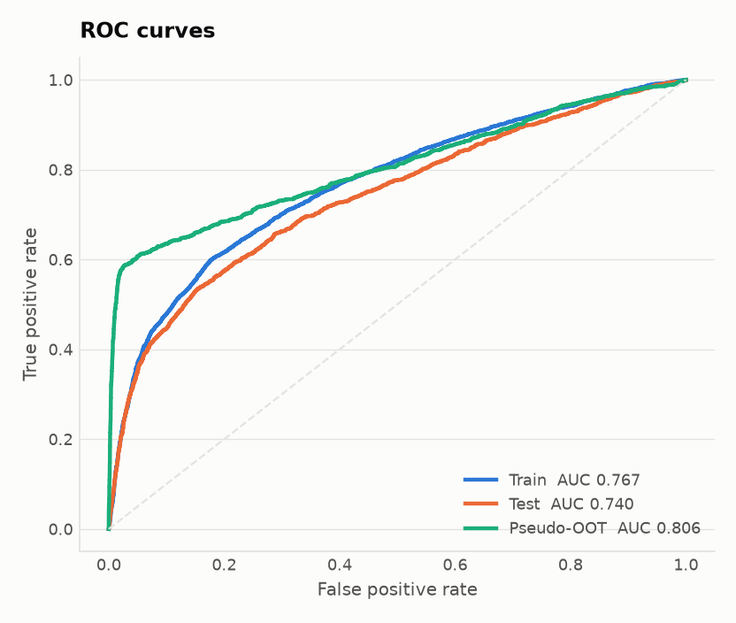
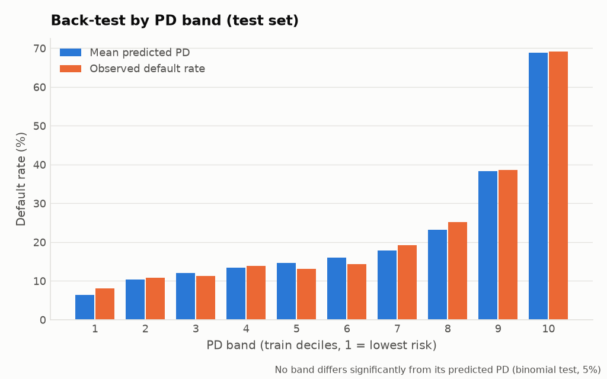
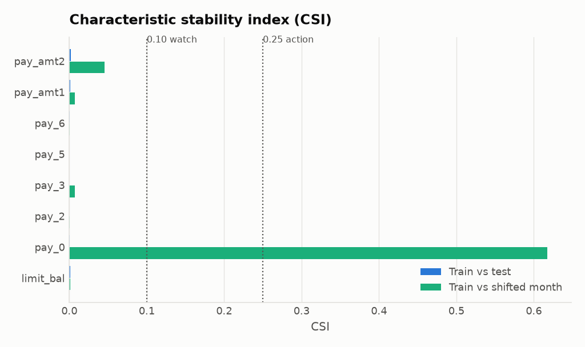
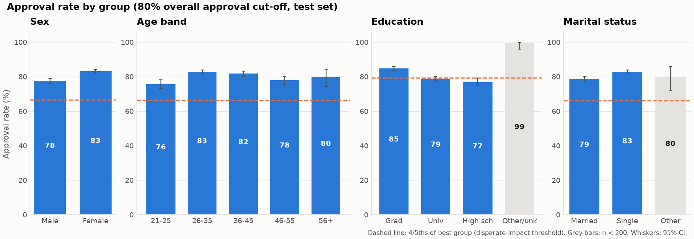
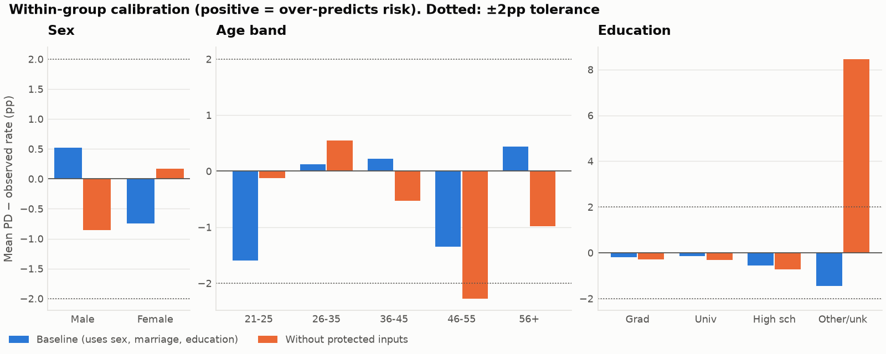

# Independent Model Validation Report: M2 Taiwan Card-Default PD

| | |
|---|---|
| **Model** | Taiwan Card-Default Logistic PD (Traditional Score) (`M2`), binomial/logit GLM |
| **Source** | R `input/m2_taiwan/model.R`; developer: Third party (public Kaggle notebook author) |
| **Model under validation** | `output/m2_taiwan/model/m2_taiwan_pd.py` (sha256 `9d9c4e58426b`), generated by the Migration Agent (Claude Opus 5.5 (Claude Code, migration-agent)); migration status AWAITING_HUMAN_APPROVAL |
| **Documentation** | `output/m2_taiwan/reports/documentation/MODEL_CARD_M2.md` (Documentation Agent, DRAFT - AWAITING HUMAN APPROVAL) |
| **Use** | Account management - credit-limit reviews and collections prioritisation (simulated bank) |
| **Framework** | PRA SS1/23 (Principles 3 and 4), Equality Act 2010, FCA Consumer Duty |
| **Validator** | Agentic Model Risk Factory (independent of the developer) |
| **Report date** | 2026-11-13 |
| **Overall outcome** | **🔴 Not approved in its current form. Variant B (without sex and marital status) is approved subject to conditions F2–F5** |

## 1. Executive summary

- **The model works.** Test AUC is 0.740. Across 200 random train/test splits the AUC averages 0.759 ± 0.005, so the split used here is a pessimistic one. Calibration is good: the average PD is within 0.24pp of the observed default rate, and no PD band fails its back-test.
- **The agent-generated Python module matches the R original exactly**, and the validator confirmed it independently. Coefficients, PDs, AUC and every accept/decline decision agree to floating-point precision (§3).
- **Approval outcomes pass the four-fifths rule for every group.** Disparate impact ratios are sex 0.933, age 0.914, education 0.907 and marital status 0.951. PDs are calibrated within ±2pp inside every large group.
- **But the model uses sex and marital status as inputs.** That is a legal and conduct issue however good the outcome metrics look. Removing both costs **no accuracy** (AUC +0.0015) and narrows the gap between men's and women's approval rates.
- **There are data-quality problems** (F2, F3): undocumented category codes, and repayment status coded differently from month to month. These need fixing before redevelopment.

| Area | Rating | Evidence |
|---|---|---|
| Reproducibility & Python rebuild | 🟠 Amber | Python parity **PASS** (coefficients agree to 3e-14). The original source recorded no seed. |
| Discrimination | 🟢 Green | Test AUC 0.740 (95% CI 0.727–0.753), Gini 0.480, KS 0.381 |
| Calibration & back-test | 🟢 Green | Mean PD 21.9% vs observed 22.1%. Hosmer–Lemeshow p = 0.12. 0 of 10 bands flagged |
| Stability | 🟠 Amber | PSI train→test 0.002, train→shifted month 0.083. pay_0 CSI 0.62, which is a data-coding artefact |
| Model specification | 🟠 Amber | pay_0 is not linear (LR test p < 0.001). The gradient-boosting challenger scores +3.3 AUC points |
| Fairness: outcomes | 🟢 Green | All disparate impact ratios (DIR) ≥ 0.80. Sex 0.933, age 0.914, education 0.907. Within-group calibration within ±2pp |
| Fairness: legal / conduct | 🔴 Red | **Sex and marital status are direct model inputs** |

## 2. Scope and data

- **Data:** UCI #350 Default of Credit Card Clients (Yeh & Lien, 2009), CC BY 4.0. 30,000 credit-card clients, Taiwan bank, observed Apr-Sep 2005 (6 monthly snapshots).
- **Target:** default.payment.next.month: binary indicator of default payment in the month following the observation window (1 = default / Yes, 0 = no default / No, per the notebook's plot labels 'Default payment next month (1-Y, 0-N)'). Read from the CSV column 'default payment next month', which read.csv renames to default.payment.next.month; converted to a factor at line 30 so the model estimates the probability of level '1'. The underlying definition of 'default' (days past due, amount threshold) is not stated in the source or supporting document.
- **Split:** stratified 70/30, with 21,001 training rows and 8,999 test rows. The split is frozen in `output/m2_taiwan/model/reference/split.csv`.
- **Model inputs (11):** limit_bal, sex, education, marriage, pay_0, pay_2, pay_3, pay_5, pay_6, pay_amt1, pay_amt2.
- **Documented limitations:** the model card lists 12 (5 high) and 9 open questions for the owner; this report tests them.
- **Protected characteristics:** sex and marital status are used directly. Age is available but not used. Education is treated as a potential proxy.
- **Out of scope:** the notebook's rpart and random-forest challengers are listed in the inventory only.

## 3. Reproducibility and Python rebuild (parity)

The Migration Agent ran the legacy R script unmodified, froze its outputs, and generated `output/m2_taiwan/model/m2_taiwan_pd.py`. The validator then re-ran that exact module (SHA-256 checked against the agent's manifest) on the frozen split with its own code and tolerances (`agent/validators/m2_taiwan/parity.py`). **Result: PASS.** An independent scikit-learn fit agrees as well.

| Check | Observed | Tolerance | Pass |
|---|---|---|---|
| artefact: module SHA-256 differs from agent manifest | 0.00e+00 | 0e+00 | ✅ |
| term names/order differ from R model.matrix | 0.00e+00 | 0e+00 | ✅ |
| split: rows with different train/test membership | 0.00e+00 | 0e+00 | ✅ |
| target: rows with different y | 0.00e+00 | 0e+00 | ✅ |
| coef max abs diff | 1.35e-14 | 1e-08 | ✅ |
| coef max rel diff | 3.11e-14 | 1e-06 | ✅ |
| std error max rel diff | 5.05e-15 | 1e-06 | ✅ |
| PD max abs diff (all 30,000 rows) | 8.66e-15 | 1e-10 | ✅ |
| residual deviance abs diff | 2.91e-11 | 1e-06 | ✅ |
| AIC abs diff | 2.91e-11 | 1e-06 | ✅ |
| test AUC abs diff | 0.00e+00 | 1e-12 | ✅ |
| test KS abs diff | 0.00e+00 | 1e-12 | ✅ |
| decisions differing at PD 0.50 cut-off 0.5000 (excl. 0 exact-tie rows) | 0.00e+00 | 0e+00 | ✅ |
| decisions differing at 80% approval cut-off 0.2877 (excl. 0 exact-tie rows) | 0.00e+00 | 0e+00 | ✅ |

The full coefficient-by-coefficient comparison is in `parity/parity_report_M2.md`.

## 4. Discrimination

| | Train | Test | Test 95% CI (bootstrap, 1,000 resamples) |
|---|---|---|---|
| AUC | 0.767 | 0.740 | 0.727–0.753 |
| Gini | 0.535 | 0.480 | |
| KS | 0.422 | 0.381 | 0.359–0.407 |

- **Overfitting:** the train-minus-test AUC gap is 0.027. It is small, and the seed analysis shows it is mostly an effect of this particular split.
- **Repeated-split AUC (200 seeds):** mean 0.759, 95% range 0.748–0.769. The notebook's reported 0.754 falls inside this range.
- **Challenger** (gradient boosting on all 23 features): AUC 0.773, which is +3.3 points better (see F5).

## 5. Calibration and back-test

- **Brier score:** 0.1409, against 0.1722 for a model that predicts the base rate for everyone.
- **Calibration-in-the-large:** -0.24pp.
- **Calibration slope:** 0.936. A value of 1 is ideal; below 1 means the predictions are slightly too spread out.
- **Hosmer–Lemeshow:** χ² = 12.9, df = 8, p = 0.115.

| PD band | n | Mean PD | Observed | Gap | Binomial p | Flag |
|---|---|---|---|---|---|---|
| 1 | 899 | 6.5% | 8.0% | -1.56pp | 0.07 | ok |
| 2 | 891 | 10.3% | 10.9% | -0.57pp | 0.58 | ok |
| 3 | 864 | 12.0% | 11.2% | +0.81pp | 0.50 | ok |
| 4 | 903 | 13.4% | 14.0% | -0.55pp | 0.63 | ok |
| 5 | 922 | 14.6% | 13.1% | +1.49pp | 0.21 | ok |
| 6 | 950 | 16.1% | 14.3% | +1.77pp | 0.15 | ok |
| 7 | 966 | 17.9% | 19.3% | -1.40pp | 0.26 | ok |
| 8 | 886 | 23.3% | 25.2% | -1.90pp | 0.19 | ok |
| 9 | 838 | 38.4% | 38.7% | -0.29pp | 0.86 | ok |
| 10 | 880 | 68.8% | 69.1% | -0.29pp | 0.88 | ok |

## 6. Stability

- **Population stability index (PSI) of the score:** train vs test 0.0016. Train vs the **shifted month** 0.0826. In the shifted month every client is re-scored as at Aug-2005, one month earlier, as a pseudo out-of-time test. Both values are below the 0.10 watch level.
- **Pseudo out-of-time discrimination:** AUC 0.806 against a proxy outcome, a Sep-2005 repayment delay (22.3% event rate). The proxy is easier to predict than true default, so this is a lower bound on instability, not a like-for-like AUC.
- **Characteristic stability index (CSI) for pay_0 in the shifted month = 0.62.** This is **not population drift**. Code 1 exists only in PAY_0 (see F3), so moving a month back changes how the variable is coded. That makes it a data-definition finding, and it is why stability is rated Amber.

| Variable | CSI train→test | CSI train→shifted month |
|---|---|---|
| limit_bal | 0.0011 | 0.0011 |
| pay_0 | 0.0003 | 0.6175 |
| pay_2 | 0.0001 | 0.0006 |
| pay_3 | 0.0000 | 0.0073 |
| pay_5 | 0.0000 | 0.0000 |
| pay_6 | 0.0005 | 0.0005 |
| pay_amt1 | 0.0013 | 0.0072 |
| pay_amt2 | 0.0017 | 0.0455 |

## 7. Model specification

- **pay_0 linearity:** banding pay_0 as {0, 1, 2, 3+} improves the fit (LR = 241, df = 2, p < 0.001) but adds only +0.0012 test AUC. The non-linearity is statistically significant but makes little difference in practice.
- **Dropped variables:** age, pay_4, bill amounts and pay_amt3–6 together give LR = 32.2 on 12 df (p = 0.001). Selection by p-value left some signal out.
- **Multicollinearity:** the highest variance inflation factor (VIF) is 2.67, so collinearity is not a concern.
- **Cut-off policy** (test set):

| Cut-off | PD threshold | Approval rate | Defaulters declined | Good customers declined | Bad rate among approved |
|---|---|---|---|---|---|
| pd_0.50 | 0.500 | 89.6% | 32.2% | 4.3% | 16.7% |
| approve_80pct | 0.288 | 80.9% | 46.8% | 11.2% | 14.5% |

## 8. Fairness assessment

**Method.** The favourable outcome is *approval* (PD below the cut-off). The headline cut-off is the one that approves 80% of applicants (PD < 0.288). PD < 0.50 was also tested and is in the JSON output. For every group the assessment computes:
- the disparate impact ratio (DIR: approval rate ÷ the best group's rate, failing below 0.80);
- equal opportunity (approval rate among customers who did not default);
- AUC within the group;
- **within-group calibration** (mean PD minus observed default rate, tolerance ±2pp).

Calibration within groups is the primary test for credit. Default rates genuinely differ between groups, so a calibrated model *cannot* also give every group the same approval rate. Small differences in approval rates that follow real differences in risk are expected.

### 8.1 Sex
| Group | n | Default rate | Mean PD | Calibration gap | AUC | Approval rate (95% CI) | Approval of good payers | DIR vs best |
|---|---|---|---|---|---|---|---|---|
| Male | 3,575 | 23.9% | 24.4% | +0.52pp | 0.757 | 77.6% (76%–79%) | 86.4% | 0.933 |
| Female | 5,424 | 20.9% | 20.2% | -0.75pp | 0.726 | 83.1% (82%–84%) | 90.3% | 1.000 |

Women are approved more often (83% vs 78%). That matches their lower observed default rate, and both groups are calibrated within 1pp. Part of the gap, however, comes from the **sex input itself** (F1).

### 8.2 Age (not a model input)
| Group | n | Default rate | Mean PD | Calibration gap | AUC | Approval rate (95% CI) | Approval of good payers | DIR vs best |
|---|---|---|---|---|---|---|---|---|
| 21-25 | 1,164 | 26.5% | 25.0% | -1.59pp | 0.736 | 75.7% (73%–78%) | 85.3% | 0.914 |
| 26-35 | 3,903 | 20.4% | 20.5% | +0.12pp | 0.738 | 82.8% (82%–84%) | 89.8% | 1.000 |
| 36-45 | 2,579 | 21.1% | 21.3% | +0.22pp | 0.721 | 81.8% (80%–83%) | 88.9% | 0.988 |
| 46-55 | 1,110 | 25.3% | 24.0% | -1.35pp | 0.778 | 77.8% (75%–80%) | 88.2% | 0.940 |
| 56+ | 243 | 24.7% | 25.1% | +0.44pp | 0.714 | 79.8% (74%–84%) | 88.5% | 0.964 |

### 8.3 Education
| Group | n | Default rate | Mean PD | Calibration gap | AUC | Approval rate (95% CI) | Approval of good payers | DIR vs best |
|---|---|---|---|---|---|---|---|---|
| Graduate school | 3,160 | 19.2% | 19.1% | -0.19pp | 0.717 | 84.8% (83%–86%) | 90.2% | 0.854 |
| University | 4,245 | 23.6% | 23.5% | -0.14pp | 0.749 | 78.8% (78%–80%) | 88.0% | 0.794 |
| High school | 1,458 | 25.3% | 24.7% | -0.56pp | 0.744 | 76.9% (75%–79%) | 86.6% | 0.775 |
| Other/unknown ⚠️ | 136 | 7.4% | 5.9% | -1.44pp | 0.581 | 99.3% (96%–100%) | 100.0% | 1.000 |

⚠️ means n < 200, so treat the figure with caution. The 99% approval rate for "Other/unknown" is the data artefact described in F2.

### 8.4 Marital status
| Group | n | Default rate | Mean PD | Calibration gap | AUC | Approval rate (95% CI) | Approval of good payers | DIR vs best |
|---|---|---|---|---|---|---|---|---|
| Married | 4,054 | 23.2% | 23.7% | +0.54pp | 0.751 | 78.7% (77%–80%) | 87.6% | 0.951 |
| Single | 4,822 | 21.3% | 20.3% | -0.96pp | 0.732 | 82.8% (82%–84%) | 89.8% | 1.000 |
| Other ⚠️ | 123 | 20.3% | 22.5% | +2.13pp | 0.747 | 79.7% (72%–86%) | 87.8% | 0.963 |

### 8.5 What happens without the protected inputs (ablation)
| Variant | Test AUC | DIR sex | DIR age | DIR education* | Worst calibration gap: sex / age / education* | New flags |
|---|---|---|---|---|---|---|
| A. Baseline (as built) | 0.7402 | 0.933 | 0.914 | 0.907 | 0.75 / 1.59 / 0.56 pp | none |
| B. Without sex and marital status | 0.7417 | 0.957 | 0.894 | 0.899 | 0.81 / 2.33 / 0.60 pp | calibration gap 2.3pp > 2.0pp (46-55) |
| C. Without sex, marital status and education | 0.7400 | 0.958 | 0.892 | 0.898 | 0.86 / 2.27 / 0.71 pp | calibration gap 2.3pp > 2.0pp (46-55) |

\* Education figures exclude the "Other/unknown" group (n = 136), which is too small to measure reliably.

- **Removing sex and marital status (B)** costs no accuracy, reduces the sex gap, and leaves both sexes calibrated within 1pp. The trade-off is that marital status was partly standing in for age: the 46–55 band moves to 2.3pp under-prediction, just outside tolerance.
- **Removing education as well (C)** does *not* narrow the gap between the large education groups (DIR 0.907 → 0.898). The education differences reach the score through repayment history, which reflects real behaviour. Removing the input also leaves the small "Other/unknown" group over-predicted by about 8pp, because that group's low default rate is a data artefact the model can no longer see. **Variant B is therefore preferred.** Education can stay in once its codes are cleaned (F2).

### 8.6 Proxy analysis
These are AUCs for predicting each protected characteristic from the **non-protected** model inputs alone (credit limit, repayment history, payment amounts). 0.5 means the inputs carry no information about the characteristic.

| Protected characteristic | Proxy AUC |
|---|---|
| sex=female | 0.588 |
| age<=25 | 0.779 |
| age>=56 | 0.519 |
| marital=single | 0.562 |

The inputs say little about sex or marital status. They do strongly identify **young applicants** (AUC 0.78), mainly through credit limit. So the model can disadvantage young applicants through those inputs even though age itself is not used (F6).

### 8.7 Mitigation options considered
- **Removing the protected inputs (recommended):** this is variant B.
- **Group-specific thresholds** (e.g. fairlearn `ThresholdOptimizer`): *rejected.* Setting different cut-offs by sex would itself be direct discrimination under UK law.
- **Fairness-constrained training** (e.g. `ExponentiatedGradient`): not needed. Once the inputs are removed, the only breach is the 46–55 band's calibration gap, which exceeds the ±2pp tolerance by about 0.3pp. That is handled by recalibration and age-band monitoring (F6), not by constraining the model.

## 9. Findings and actions

| ID | Severity | Finding | Required action | Owner | Due |
|---|---|---|---|---|---|
| F1 | High | Sex and marital status are used as direct inputs (sex2 = −0.17: women are scored as lower risk; marriage2 = −0.25: single people are scored as lower risk). This is direct discrimination risk under the Equality Act 2010 s.13, and there is no financial-services exception for sex in credit decisions. | Remove both inputs (variant B). Test AUC changes by +0.0015, which is no loss, and the sex DIR improves by +0.024. Re-validate the variant before use. | Model owner | Before next use |
| F2 | Medium | Undocumented category codes: education 0/5/6 (345 rows) and marriage 0 (54 rows) are folded into "others". This produces a spurious education4 coefficient of -1.18 (SE 0.23), and the "Other/unknown" group gets 99% approval. | Confirm the code meanings with the data owner. Treat unknown codes as missing, not as a category with a score benefit. | Data owner | 30 days |
| F3 | Medium | Repayment-status coding differs by month. Code 1 (one-month delay) appears 3,688 times in PAY_0 but only 28/4/2/0/0 times in PAY_2–PAY_6. The author also merged −2/−1/0 into 0 by assumption. | Get the field definitions confirmed. Recode delinquency consistently across months, then refit. | Data owner / developer | 30 days |
| F4 | Medium | The model can't be reproduced from source: no random seed was recorded, and the accuracy-maximising cut-off was tuned on the test set. That cut-off also lands exactly on an observed score, so ties occur. | Freeze the split (done: the agent's frozen reference, split.csv). Set a policy cut-off from risk appetite on development data, not the test set. | Model owner | Done / 30 days |
| F5 | Medium | The model is under-specified. pay_0 is non-linear (LR statistic 241, p < 0.001). Dropped variables are jointly significant (p = 0.001). A gradient-boosting challenger reaches AUC 0.773, against 0.740 for the model. | Consider a banded/WoE treatment of the delinquency variables. Record the rationale for keeping an interpretable GLM. | Developer | Next redevelopment |
| F6 | Low | Age is not a model input, but the remaining inputs predict age ≤ 25 with AUC 0.78, mainly through credit limit. Applicants aged 21–25 have the lowest approval rate (76%). After removing sex and marital status, the 46–55 band is under-predicted by 2.3pp, just outside the ±2pp tolerance. | Recalibrate variant B and confirm the 46–55 gap is back within ±2pp. Monitor age-band calibration quarterly. Document the risk-based justification for any age effect (Equality Act Sch. 3 para 20A). | Model owner | Quarterly |
| F7 | Low | The data is Taiwan 2005 and is not representative of a UK retail book. Two groups are small: education "Other/unknown" (n = 136) and marital status "Other" (n = 123), so their confidence intervals are wide. | Re-validate on UK data before any production use. | Model owner | Before deployment |

## 10. Ongoing monitoring and re-validation triggers

| Metric | Watch (amber) | Re-validate (red) |
|---|---|---|
| Score PSI (vs development) | ≥ 0.1 | ≥ 0.25 |
| Any input CSI | ≥ 0.1 | ≥ 0.25 |
| AUC fall from validated test AUC (abs.) | ≥ 0.03 | ≥ 0.05 |
| Calibration-in-the-large (pp) | ≥ 1.0 | ≥ 2.0 |
| DIR for any protected group | < 0.85 | < 0.8 |
| Within-group calibration gap (pp) | ≥ 1.5 | ≥ 2.0 |

_Thresholds from `agent/config/thresholds.yaml` (monitoring)._

Monitoring runs these checks on every scoring batch (`/mrf:monitor m2_taiwan`, results in `monitoring/`); any red metric raises a re-validation trigger in the model inventory.

## 11. Limitations of this validation

- There is no true out-of-time sample. The pseudo-OOT test uses a proxy outcome.
- Fairness is measured on observed attributes only. Intersectional groups (e.g. young women) were not tested.
- The data is public and non-UK, and was used as a stand-in for this exercise.

## Appendix: reproduce

In Claude Code: `/mrf:run m2_taiwan` (or in Codex: the `run` skill). Thresholds: `agent/config/thresholds.yaml`.

Every run is logged to MLflow under the experiment `m2-taiwan-default`, in Azure ML when `agent/config/azure.env` is set and in `output/mlflow/` otherwise.
